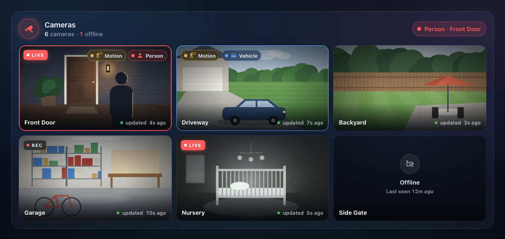

# Glasshouse Camera Card

A security-camera wall for Home Assistant. Each camera gets a tile with a snapshot that refreshes
in the background and crossfades to the next frame, detection badges for motion, people and
vehicles, and a live view that opens inside the card. It replaces the stock picture-entity cards,
which show grey boxes with spinners while they load. Part of the **Glasshouse** suite: refined dark
glass, one accent per device type, live data.



## Features

- **Zoom in place**: pinch, trackpad pinch or double-tap a tile to zoom into the picture without opening the live view; drag to look around, tap the pill to reset.

- **Snapshot tiles** from each camera's `entity_picture` (`/api/camera_proxy/…`). Every `refresh`
  seconds a new frame loads in the background and **crossfades** over the old one. A spinner never
  covers a frame that is already on screen. The first load shows a quiet shimmering skeleton.
- **Refreshes only while you can see it.** Polling pauses when the card scrolls out of view
  (IntersectionObserver), when the browser tab is hidden, and while the live view is open. When you
  come back, stale tiles refresh straight away. A new `entity_picture` token from Home Assistant
  also loads a fresh frame at once.
- **Overlay** on each tile: the camera name and an "updated 4s ago" label with a heartbeat dot
  that turns amber when frames go stale. A **REC** pill appears when the camera reports `recording`.
  Tiles playing live video (`live: true`) and the full live view show no LIVE pill.
- **Detection badges** in the top-right corner for optional `motion`, `person` and `vehicle` binary
  sensors: a pulsing red dot for a person, amber for motion, blue for a vehicle. The tile gets a
  matching ring, and a person detection gives it a slow red alert pulse.
- **Header** (when `title` is set) with a camera count, how many are offline, and a status chip:
  `All clear`, or the most important current detection, such as `Person · Front Door`.
- **Calm offline tiles.** An `unavailable` camera, or one whose snapshots keep failing, shows a
  camera-off icon with "Last seen 12m ago". If a frame was seen before, it stays behind the message,
  blurred and dimmed. A single failed refresh keeps the last frame.
- **Live view:** tap a tile to open a full-screen-style view (a modal `<dialog>` over a blurred
  backdrop) that plays the camera through Home Assistant's own `<ha-camera-stream>`, which handles
  HLS and WebRTC. It shows the detection badges and has a details button and a close button.
  Escape or a click on the backdrop also closes it. Closing it stops the stream. If
  `ha-camera-stream` isn't available, it falls back to snapshots that refresh every 2 seconds.
- **Gestures:** tap = `tap_action` (live view by default), hold (500 ms) = more-info,
  Enter / Space = tap.
- Sections view ready (`columns: full`, `rows: auto`). Auto grid with 1 column on phones, 2 on
  tablets and 3 on wide screens, or a fixed number. Keyboard and screen-reader friendly. Respects
  `prefers-reduced-motion`.
- No dependencies and no build step: one JavaScript file.

## Installation

### HACS (custom repository)

1. HACS → ⋮ → **Custom repositories**.
2. Add `https://github.com/petergCA/glasshouse-camera-card` with type **Dashboard**.
3. Install **Glasshouse Camera Card**, then reload the browser.

### Manual

1. Copy `glasshouse-camera-card.js` to `config/www/`.
2. Settings → Dashboards → ⋮ → **Resources** → add `/local/glasshouse-camera-card.js` as a
   **JavaScript module**.

For the full look, pair it with the **Glasshouse** theme.

## Configuration

| Option | Type | Default | Description |
|---|---|---|---|
| `type` | string | **required** | `custom:glasshouse-camera-card` |
| `title` | string | – | Card title. When it's set, the header (count, offline, status chip) is shown. |
| `columns` | number or `auto` | `auto` | Grid columns (1–6). `auto` = 1 below 520 px, 2 from 520 px, 3 from 900 px (4 when the camera count fills rows of 4 but not 3, e.g. 8). |
| `aspect_ratio` | string | `16:9` | Tile shape: `16:9`, `4:3`, `1:1`, `56.25%` or a number. |
| `live` | boolean | `false` | Tiles play live video (Home Assistant's own `ha-camera-stream`, muted) while the card is on screen and the tab is visible; snapshots stay underneath as the poster/fallback. Per camera `live: false` opts one out. |
| `zoom` | boolean | `true` | Zoom into a tile on the dashboard: pinch (touch), pinch on a trackpad or ctrl+scroll (desktop), or double-tap to zoom 2.5× at that spot (double-tap again to zoom out). Drag to move around while zoomed; a small `2.5× ⟲` pill resets it. While zoomed a tap doesn't open the live view. A single tap waits ~0.3 s to tell it from a double tap; `zoom: false` makes taps instant. |
| `max_zoom` | number | `4` | Largest zoom (1–10). |
| `refresh` | number | `10` | Seconds between snapshot refreshes while the card is visible. `0` = only when Home Assistant reports a new picture. Values between 0 and 1 are rounded up to 1. |
| `tap_action` | string | `live` | Default tap action for every camera (see below). |
| `info_bar` | string | `always` | `hover` hides the bottom bar (name, last update, sound button) until you point at a tile with a mouse; on a touch screen the first tap shows it for 4 s and a tap while it shows opens the live view. It stays up while a tile's sound is on. |
| `cameras` | list | **required** | Cameras, as entity ids or objects (below). |

Camera options:

| Option | Type | Description |
|---|---|---|
| `entity` | entity | **Required.** The camera entity. |
| `name` | string | Display name (defaults to the friendly name). |
| `motion` | entity | Binary sensor. Amber badge while `on`. |
| `person` | entity | Binary sensor. Pulsing red badge and alert ring while `on`. |
| `vehicle` | entity | Binary sensor. Blue badge while `on`. |
| `stream` | entity | Camera entity to stream in the tile (e.g. a low-res sub-stream), while `entity` is used for snapshots and the full-screen live view. |
| `position` | string | Which part of a wide frame the tile shows: `left`, `center`, `right`, `top`, `bottom`, or `"x% y%"` (e.g. `"85% 50%"`). Default centre. |
| `pan` | boolean | Drag a tile to look at another part of the frame (default `true`; card-level `pan: false` turns it off everywhere). The spot you leave it at is remembered in this browser. |
| `tap_action` | string | `live` (in-card live view), `more-info` (Home Assistant dialog) or `none`. `{action: more-info}` also works. |

### Theming

Every design token can be overridden from a theme with a `glasshouse-*` variable, for example
`glasshouse-surface`, `glasshouse-radius`, `glasshouse-radius-sm`, `glasshouse-gap`,
`glasshouse-alert`, `glasshouse-warn`, `glasshouse-info`.

## Examples

Minimal:

```yaml
type: custom:glasshouse-camera-card
cameras:
  - camera.front_door
  - camera.driveway
```

Full:

```yaml
type: custom:glasshouse-camera-card
title: Cameras
columns: 3
aspect_ratio: "16:9"
refresh: 10
cameras:
  - entity: camera.doorbell
    name: Doorbell
    motion: binary_sensor.doorbell_motion
    person: binary_sensor.doorbell_person
  - entity: camera.driveway
    motion: binary_sensor.driveway_motion
    vehicle: binary_sensor.driveway_vehicle
  - entity: camera.backyard
    motion: binary_sensor.backyard_motion
  - entity: camera.garage
    tap_action: more-info
```

A low-traffic wall that only updates when Home Assistant rotates the picture token:

```yaml
type: custom:glasshouse-camera-card
refresh: 0
aspect_ratio: "4:3"
columns: 2
cameras:
  - camera.nursery
  - camera.side_gate
```

## Notes

- Snapshots come from Home Assistant's camera proxy, so they work for any camera integration.
  Each request is a full JPEG, so a lower `refresh` on many cameras costs more bandwidth. The card
  only polls while it's on screen.
- The live view uses Home Assistant's `ha-camera-stream`. Whether it plays HLS, WebRTC or MJPEG
  depends on the camera integration and your Home Assistant setup.

## Development

`test/harness.html` runs the card offline in a browser with a mock `hass` and painted demo camera
frames (`test/frames.js`). Query options: `?badges`, `?offline`, `?live=camera.front_door`,
`&stream`, `&phone`, `&cols=N`, `&aspect=4:3`. `test/shot.sh` takes headless Chrome screenshots.
`test/camera.test.cjs` runs the behaviour tests (refresh scheduling, visibility gating, URL building,
offline handling, badges, live view and gestures) under Node with jsdom installed in a scratch
directory.

## License

MIT © 2026 Peter Gray
